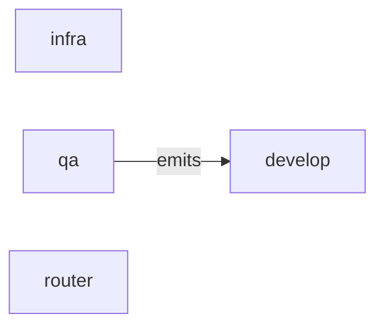

# All machines

Every machine, the `emits` and `invokes` edges between them, and cron entry points.

- [develop](develop.md): Implement a message with the AI in small, logged steps, run the project's gate, have the AI fix failures only if the gate fails, then have the AI check the acceptance criteria.
- [infra](infra.md): Add to the environment the project needs, the first time and every time after; the AI declares each resource in scripts/infra/requirements, then apply installs what is missing and checks every line.
- [qa](qa.md): Attack the project to make it misbehave, and hand each real bug to develop as a failing test; the AI writes tests only and never fixes code.
- [router](router.md): Ask an AI CLI (claude, opencode or copilot) to pick one of the options in the request.

