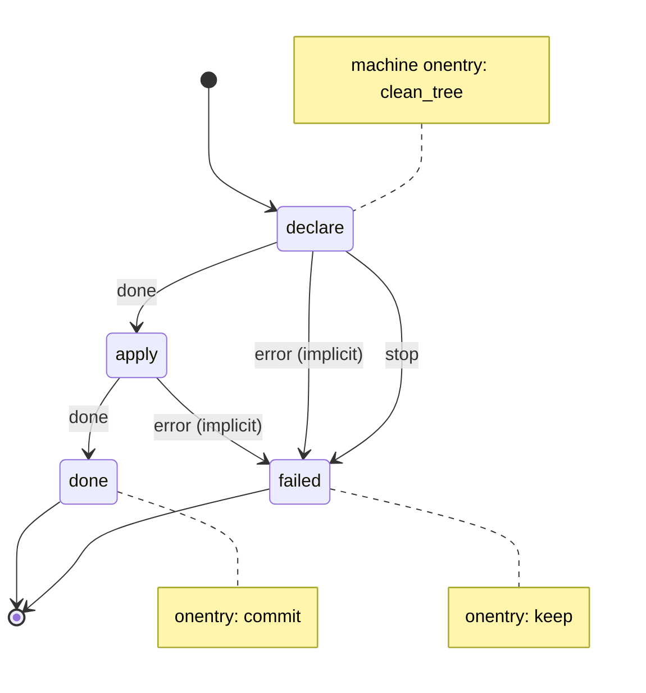

# infra

Add to the environment the project needs, the first time and every time after; the AI declares each resource in machines/infra/scripts/requirements, then apply installs what is missing and checks every line.

Machine: [machines/infra/machine.yml](machine.yml)

