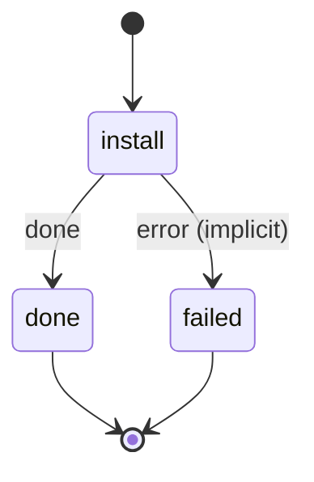

# skill

Keep the decree skill in the project, .claude/skills/decree/ or .github/skills/decree/, the one this decree ships, each time the daemon starts.

Machine: [machines/skill/machine.yml](machine.yml)

