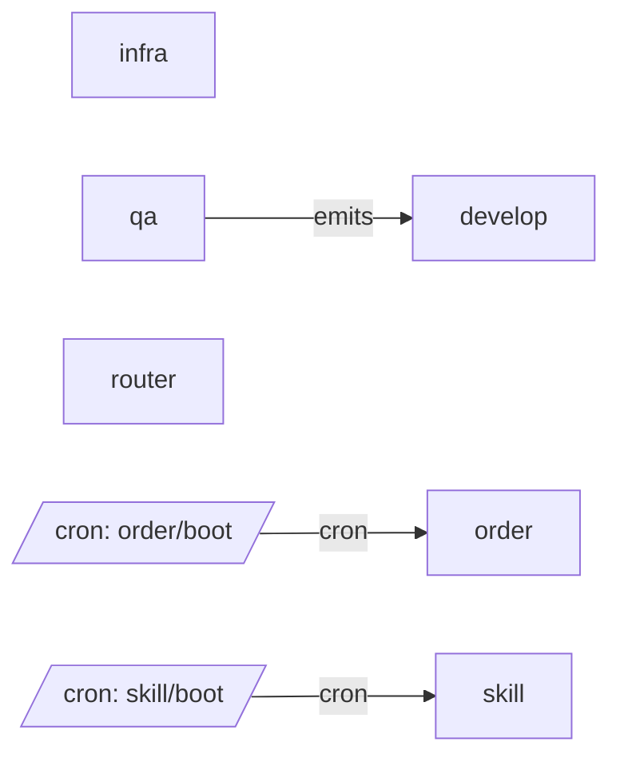

# All machines

Every machine, the `emits` and `invokes` edges between them, and cron entry points.

- [develop](machines/develop/graph.md): Implement a message with the AI in small, logged steps, run the project's gate, have the AI fix failures only if the gate fails, then have the AI check the acceptance criteria.
- [infra](machines/infra/graph.md): Add to the environment the project needs, the first time and every time after; the AI declares each resource in machines/infra/scripts/requirements, then apply installs what is missing and checks every line.
- [order](machines/order/graph.md): At daemon start, run each machine's order/ files one at a time in file-name order, once each, and again when a file changes.
- [qa](machines/qa/graph.md): Attack the project to make it misbehave, and hand each real bug to develop as a failing test; the AI writes tests only and never fixes code.
- [router](machines/router/graph.md): Ask an AI CLI (claude, opencode or copilot) to pick one of the options in the request.
- [skill](machines/skill/graph.md): Keep the decree skill in the project, .claude/skills/decree/ or .github/skills/decree/, the one this decree ships, each time the daemon starts.

