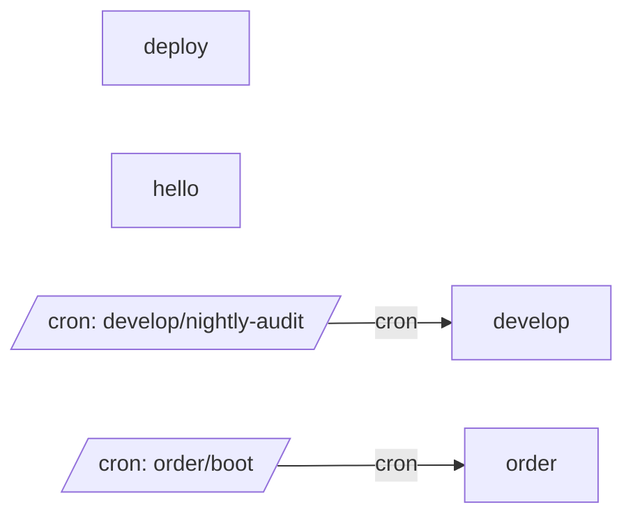

# All machines

Every machine, the `emits` and `invokes` edges between them, and cron entry points.

- [deploy](machines/deploy/graph.md): Build, ask a person to approve, then ship.
- [develop](machines/develop/graph.md): Implement a message, then test it.
- [hello](machines/hello/graph.md): Run one script.
- [order](machines/order/graph.md): At daemon start, run each machine's order/ files one at a time in file-name order, once each, and again when a file changes.

