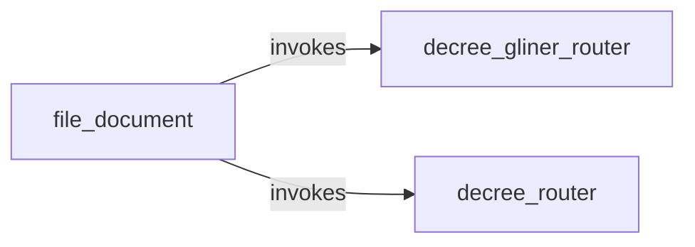

# All machines

Every machine, the `emits` and `invokes` edges between them, and cron entry points.

- [decree_gliner_router](machines/decree_gliner_router/graph.md): Ask the local GLiNER2.5-Decide classifier to pick one of the options in the request.
- [decree_router](machines/decree_router/graph.md): Ask Claude to pick one of the options in the request.
- [file_document](machines/file_document/graph.md): File one scanned document as an invoice, a receipt or other paperwork.

