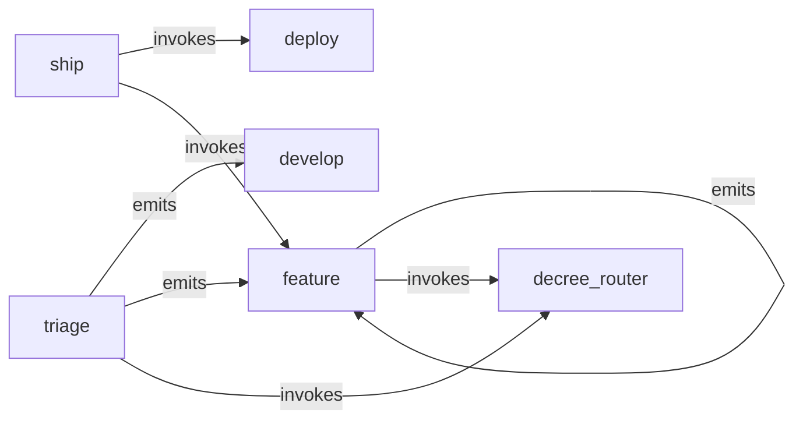

# All machines

Every machine, the `emits` and `invokes` edges between them, and cron entry points.

- [decree_router](machines/decree_router/graph.md): Ask Claude to pick one of the options in the request.
- [deploy](machines/deploy/graph.md): Build, ask a person to approve, then ship.
- [develop](machines/develop/graph.md): Make a small code change with an AI agent, then run the tests.
- [feature](machines/feature/graph.md): Implement one feature spec with an AI agent, verify it, and commit.
- [ship](machines/ship/graph.md): Implement a feature, then deploy it.
- [triage](machines/triage/graph.md): Read a free-form request and hand it to the machine that should do the work.

